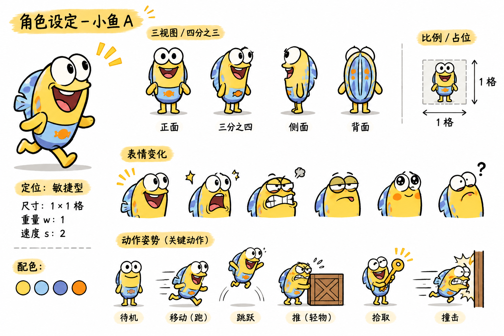
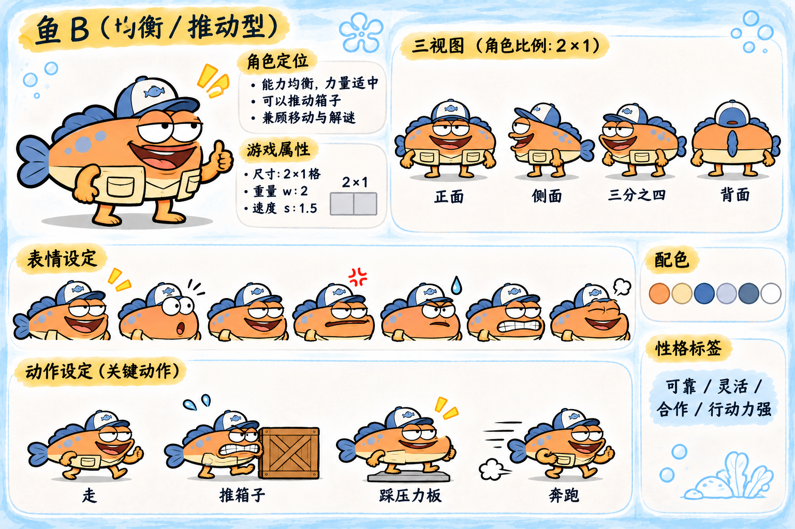
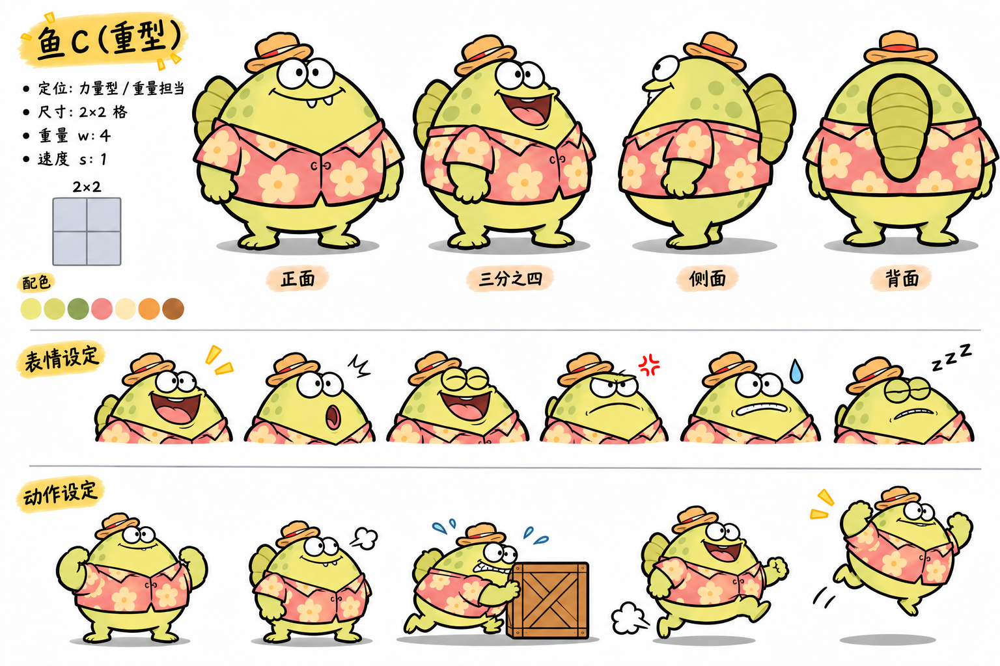

# 小鱼角色设计过程

## 设计目标与风格探索

为二维合作解谜游戏设计三条体型、重量和速度不同的小鱼，通过轮廓与配色让玩家快速识别角色分工。视觉参考《海绵宝宝》中比奇堡居民所体现的美式二维卡通风格：夸张五官、幽默表情、鲜明色块和富有弹性的肢体。三个角色在此基础上采用原创的造型、服装和配色组合，不直接复刻已有角色。

## 角色属性与造型

| 角色 | 游戏占格（宽×高） | 重量 | 速度 | 造型与配色 |
| --- | --- | --- | --- | --- |
| A：敏捷型 | 1×1 | 1 | 2 | 黄色鱼身，浅蓝与蓝紫色鱼鳍、服装，橙色点缀；轮廓轻巧、眼睛夸张，表现活泼与好奇。 |
| B：均衡／推动型 | 2×1 | 2 | 1.5 | 横扁鱼身，橙色主体、奶油色工具背心、蓝色鱼鳍与棒球帽；表现可靠、随和与合作能力。 |
| C：重量型 | 2×2 | 4 | 1 | 圆胖黄绿色鱼身，粉红色花衬衫、暖色帽子；宽大的身体和短四肢强调重量与力量。 |

上述尺寸是游戏中的占格设定，不等于整张设定图或插画外接框的像素比例。

## 三视图与结构设定

三张设定图均展示正面、侧面、背面，并补充四分之三视角，帮助后续绘制和动画制作时保持头身比例、服装、鱼鳍和四肢位置的一致性。A 以紧凑的 1×1 占位突出灵活性；B 以横向延展的 2×1 轮廓区别于其他角色；C 用接近方形占位的圆胖体型表达 2×2 的重量感。

## 表情、动作与配色

- **A**：以开心、惊讶、生气、疲惫、期待和疑惑等表情表现好奇、积极的性格。关键动作包括待机、奔跑、跳跃、推轻物、拾取钥匙与撞击。黄色和冷色蓝紫形成对比，让轻快的小体型更醒目。
- **B**：通过放松的半睁眼、微笑、惊讶、用力和紧张等表情表现可靠又幽默的性格。动作包含行走、推箱子、踩压力板和奔跑；手掌与手臂要清楚表达接触、发力和支撑关系。橙色鱼身与蓝色帽子、鱼鳍形成互补，浅色背心划分身体结构。
- **C**：通过开心、大笑、惊讶、生气、紧张和困倦等表情表现憨厚的力量担当。动作包含展示力量、休息、推动重箱、行走或奔跑以及跳跃；后续动画应通过重心变化、起落节奏表现重量。黄绿色鱼身搭配粉红花衬衫，兼顾辨识度与喜剧感。

## 迭代经历

1. **风格与角色区分**：先确定夸张、幽默、色彩鲜明的二维卡通方向，再按敏捷、均衡、重量三种分工探索轮廓，避免三个角色只有颜色差异。
2. **比例调整**：将游戏属性落实为 A 1×1、B 2×1、C 2×2 的占格关系。B 初期偏直立，与横扁定位不符，因此将身体改为横向延展，强化宽度和较低的重心。
3. **补全 B 的手臂**：在横向造型调整后补充手臂和手掌，让推箱子、踩机关与行走姿态中的肢体关系更加完整、清楚。
4. **修正多余眼睛**：根据反馈反复检查五官，针对出现多余眼睛的问题进行修改。结构标准为角色只有两只眼睛；侧面可因遮挡只显示一只，不能额外增加眼球。此处记录设计迭代经历，本次上传保留用户指定的三张原图。
5. **完善设定图**：将多视角、表情、关键动作、配色和游戏属性整合在各角色设定图中，作为后续精绘与动画制作的参考。

## 最终设定图

### 鱼 A

### 鱼 B

### 鱼 C

本次归档内容为三张角色设定图及设计过程说明；设定图用于指导后续游戏素材和 Sprite 动画制作。
