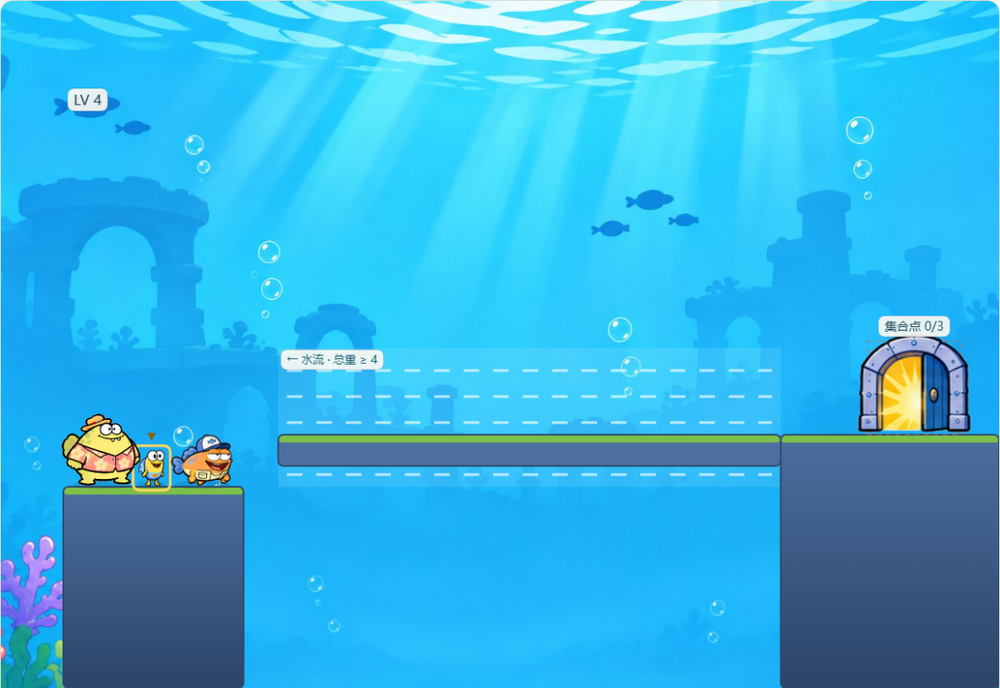

# sendhome · 送小鱼回家

[中文](#中文) · [English](#english)

二维合作解谜游戏：三条体型、重量、速度不同的小鱼，各自穿过机关，最后在集合点会合。后续开发、提交与协作统一使用本仓库的 `main` 分支。

*A 2D co-op puzzle platformer about three fish with different weights, sizes and speeds who have to meet at the checkpoint. Development and collaboration happen on `main` in this repository.*



## 中文

### 试玩

- **在线**：<https://sd5913.github.io/sendhome/>（GitHub Pages）
- **本地**：在仓库根目录运行 `python3 -m http.server 8000`，打开 <http://localhost:8000/game/?level=level-3>；页面右上角可切换关卡。
- **通关后**：画面底部会出现「下一关」按钮，直接进入下一关；最后一关会提示重新选择。

### 关卡

| 关卡 | 内容 | 地编 / 蓝本 |
| --- | --- | --- |
| 关卡 1 · 基础移动 | 三鱼切换、跳跃、跌落复位与全员集合 | [`levels/level-1.json`](levels/level-1.json) · [`lv1`](design/levels/lv1-blueprint.jpg) |
| 关卡 2 · 钥匙与重量 | 一条鱼被困房间；捡钥匙开地面门，两条鱼压住压板放出它 | [`levels/level-2.json`](levels/level-2.json) · [`lv2`](design/levels/lv2-blueprint.jpg) |
| 关卡 3 · 撞门与分工 | 石屋的鱼冲刺撞门；右侧的鱼推箱上压板、再踩箱子跳过矮墙 | [`levels/level-3.json`](levels/level-3.json) · [`lv3`](design/levels/lv3-blueprint.jpg) |
| 关卡 4 · 逆流渡桥 | 石桥上有强水流，轻鱼会被冲下悬崖；让 C 驮着 A 或 B 分批过桥 | [`levels/level-4.json`](levels/level-4.json) |
| 机关测试场 | 推箱、压板、钥匙门、冲刺破门 | [`levels/mechanics-test.json`](levels/mechanics-test.json) |

### 操作

| 操作 | 按键 |
| --- | --- |
| 移动 | `A` / `D` 或 `←` / `→` |
| 跳跃 | `W` / `空格` / `↑` |
| 切换控制的鱼 | `1` / `2` / `3`、`Tab`，或直接点击画面里的小鱼 |
| 冲刺（撞门） | `Shift` |
| 暂停 / 重置 | `Esc` / 长按 `R` |

三条鱼的属性是全局规则：A `1×1` 格、重 1、速 2；B `2×1` 格、重 2、速 1.5；C `2×2` 格、重 4、速 1。站在伙伴背上会随它移动，但负重会同时降低移动、推动和跳跃能力。

### 代码结构

所有关卡共用一套引擎和界面，关卡只是 `levels/` 下的 JSON 地编：

| 位置 | 职责 |
| --- | --- |
| [`game/engine.mjs`](game/engine.mjs) | 唯一的物理与玩法引擎：角色、碰撞、推鱼、承载、负重、箱子、压板、钥匙、门、水流、通关 |
| [`game/app.mjs`](game/app.mjs)、[`game/index.html`](game/index.html)、[`game/style.css`](game/style.css) | 共享输入、绘制、镜头、音效开关、暂停与界面 |
| [`game/audio.mjs`](game/audio.mjs) | 程序化音效 |
| [`levels/`](levels/) | 纯 JSON 地编；`index.json` 是关卡目录 |
| [`game/art/`](game/art/) | 从设计稿裁出的角色五帧、视差背景与终点门 |
| [`scripts/build_site.py`](scripts/build_site.py) | 部署打包：一份引擎 + 一份界面 + 全部地编 |
| [`scripts/build_art.py`](scripts/build_art.py) | 从 `assets/` 设定图生成透明游戏素材（需要 Pillow） |

新增普通关卡只需要添加 `levels/<id>.json` 并登记到 `levels/index.json`，不需要复制引擎或界面。

### 测试

```sh
node --test game/engine.test.mjs game/audio.test.mjs level-1/engine.test.mjs
```

覆盖关卡数据校验、三鱼移动与承载、推箱/压板/钥匙/撞门、负重跳跃、关卡 2 与关卡 3 的完整机关流程、部署打包等。

### 美术

角色设定图、五帧动画参考与场景设定图都在 [`assets/`](assets/)；`game/art/` 里的角色精灵和终点门由 `scripts/build_art.py` 从这些图裁出，背景使用成员提供的海底插画 [`background-underwater`](game/art/background-underwater-24f80eec63d1.png)。箱子、压板、钥匙等道具目前仍是几何绘制。

### 文档与进度

- [关卡手绘蓝本](design/levels/)：每关的手绘格线图与对应说明。
- [角色设计过程](CHARACTER_DESIGN.md)。
- [差异化设计方案：水流中的合作（2026-11-26，方案阶段）](docs/design/2026-11-26-current-cooperation-proposal.md)。
- 开发报告：[进度与验证](docs/reports/2026-11-26-progress.md)、[音效](docs/reports/2026-11-26-audio.md)、[仓库位置说明](docs/reports/repository-location-explanation.md)。
- 原始设计文档：[`期末teamwork.docx`](期末teamwork.docx)。

### 素材、工具与 AI 使用

- 美术为项目原创设定图；运行时是原生 ES 模块 + Canvas 2D，没有第三方前端依赖。
- 测试使用 Node.js 内置 `node:test`；素材生成脚本使用 Pillow。
- 部分代码、素材裁切脚本与文档整理在 AI 编码助手协助下完成，结果由团队成员检查后提交。

---

## English

### Overview

Three fish with different sizes, weights and speeds must work together through a series of puzzle levels. Every fish matters: light fish cannot push heavy crates, heavy riders slow a carrier down, and a fish carrying someone on its back can barely jump.

### Play

- **Online**: <https://sd5913.github.io/sendhome/>
- **Local**: run `python3 -m http.server 8000` in the repository root, then open <http://localhost:8000/game/?level=level-1>. Use the level picker at the top right.
- **After clearing a level**: a “Next level” button appears at the bottom of the canvas; the final level points you back to the level picker.

### Levels

| Level | What happens |
| --- | --- |
| Level 1 · Movement | Switch fish, jump across platforms, gather all three at the checkpoint. |
| Level 2 · Key & Weight | One fish is locked in a room. Find the key, open the ground door, then weigh down the pressure plate with two fish to free it. |
| Level 3 · Break & Split | The fish in the stone room must dash through a break door; the right-hand fish pushes the crate onto a plate and then stands on the crate to clear the tall wall. |
| Level 4 · Against the Current | A strong current sweeps light fish off the bridge; C has to carry A or B across one at a time (total weight ≥ 4). |
| Mechanics Test | Crates, plates, key doors and dash-breaking in one sandbox. |

### Controls

`A`/`D` or arrows to move · `W`/`Space`/`↑` to jump · `1`/`2`/`3`, `Tab`, or click a fish to switch · `Shift` to dash · `Esc` to pause · hold `R` to reset.

### Architecture

One shared engine and one shared UI; levels are pure JSON data.

| Path | Role |
| --- | --- |
| `game/engine.mjs` | The only physics/gameplay engine: movement, collisions, pushing, carrying, weight, crates, plates, keys, doors, completion |
| `game/app.mjs`, `game/index.html`, `game/style.css` | Shared input, rendering, camera, audio toggle, pause and UI |
| `game/audio.mjs` | Procedural sound effects |
| `level-1/`, `game-whitebox/` | Legacy URLs that redirect to the shared runtime |
| `levels/` | Data-only level JSON; `index.json` lists the catalog |
| `game/art/` | Character strips, parallax background and goal door extracted from the design sheets |
| `scripts/build_site.py` | Packages the site: one engine, one UI, all levels |
| `scripts/build_art.py` | Regenerates the game art from `assets/` (needs Pillow) |

A new ordinary level is just a new `levels/<id>.json` plus an entry in `levels/index.json` — no engine or UI copy.

### Tests

```sh
node --test game/engine.test.mjs game/audio.test.mjs level-1/engine.test.mjs
```

Covers level validation, fish movement and carrying, crate/plate/key/break-door mechanics, loaded jumps, the full level 2 and level 3 puzzle flows, and the deployment package.

### Art & credits

Character sheets, five-frame animation references and environment art live in `assets/`. The character sprites and goal door in `game/art/` are generated from them by `scripts/build_art.py`; the background is an underwater illustration supplied by a team member. No third-party art is bundled. Crates, plates and keys are still drawn as primitives.

The project uses plain ES modules and Canvas 2D with no front-end dependencies; tests use Node's built-in `node:test`. Part of the code, the art-extraction script and the documentation were prepared with an AI coding assistant and reviewed by the team before committing.
